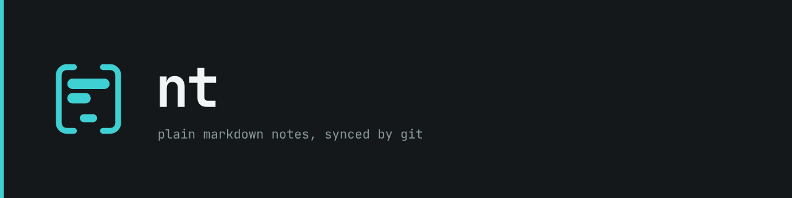
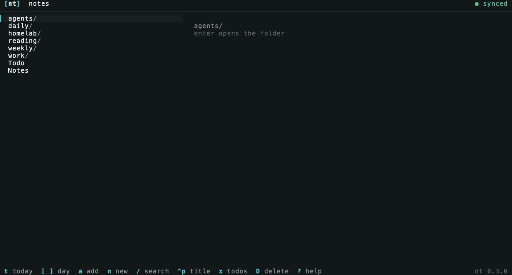
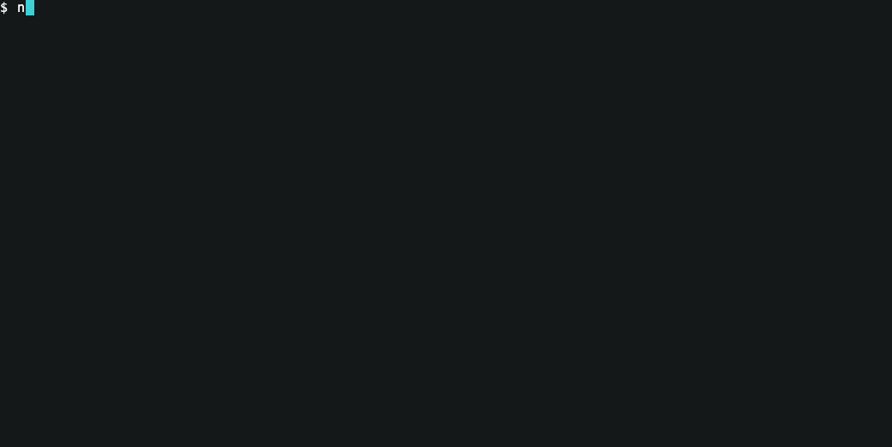

<p align="center"></p>

[](https://github.com/w4jnl/nt/actions/workflows/ci.yml)

Plain markdown notes in a folder, synced by git, read and written from the terminal. A journal
per day, dated topic notes in folders you name, todos in any note, a calendar, a weekly digest,
and a folder where coding agents report what they did. Your editor edits, git syncs, `rg`
searches; nt keeps them together and stays out of the way.

nt is a two-pane browser and a plain command line over the same folder. On the left the folders,
notes, the todo list or the month; on the right the note, rendered, with its images in terminals
that draw them. A click on a link follows it; `f` and a letter do the same from the keyboard.
Every note is GitHub markdown, so the repository reads the same on github.com, in nvim and in any
other editor.

<p align="center"></p>

<p align="center"></p>

## Setup

Current version: 0.7.0 · [release notes](CHANGELOG.md). Needs git, and `fzf` for find, `rg`
for faster search; details under [Requirements](#requirements).

1. Install the binary. Homebrew, on macOS or Linux:
   ```sh
   brew install w4jnl/tap/nt
   ```
   Or a prebuilt static binary from the [releases page](https://github.com/w4jnl/nt/releases)
   (Linux and macOS, `amd64` and `arm64`, no Go, no root):
   ```sh
   ver=0.7.0; os=$(uname -s | tr A-Z a-z); arch=$(uname -m | sed 's/x86_64/amd64/; s/aarch64/arm64/')
   curl -fsSLO "https://github.com/w4jnl/nt/releases/download/v$ver/nt_${ver}_${os}_${arch}.tar.gz"
   curl -fsSLO "https://github.com/w4jnl/nt/releases/download/v$ver/sha256sums.txt"
   shasum -a 256 -c --ignore-missing sha256sums.txt
   mkdir -p ~/.local/bin && tar -xzf "nt_${ver}_${os}_${arch}.tar.gz" --strip-components=1 -C ~/.local/bin "nt_${ver}_${os}_${arch}/nt"
   ```
2. Make the notes repository, and give it a private remote:
   ```sh
   nt init ~/notes
   git -C ~/notes remote add origin git@github.com:<you>/notes.git
   ```
   On a second machine, clone it instead: `nt init --clone git@github.com:<you>/notes.git ~/notes`.
   Coming from Obsidian: `nt import obsidian <vault> --dry-run` shows the plan, then run it
   without `--dry-run`.
3. Sync in the background, every 2 minutes (launchd on macOS, a systemd user timer on Linux):
   ```sh
   nt install --sync
   ```
4. Optional: the nvim plugin, and the agent skill:
   ```sh
   nt install --nvim    # lazy.nvim: { dir = "~/.local/share/nt/nvim", name = "nt", lazy = false }
   nt install --skill   # teach Claude Code and Copilot CLI your notes
   ```
   A report for every agent session comes from [flok](https://github.com/w4jnl/flok), with its
   `[notes]` on.
5. Open the browser with `nt`, or one folder with `nt <folder>`; `?` lists the keys.
6. Optional, on macOS 26 or later: nt for Mac, the note in live preview, nt's mark in the menu
   bar and ⌥⌘Space to add a line from anywhere. Signed and notarized, with its own nt inside:
   ```sh
   brew install --cask w4jnl/tap/nt-app   # or the DMG from the releases page
   ```

`nt doctor` checks every step: the repository, git and the remote, the sync timer, the tools nt
uses, the nvim plugin, the agent reports and the skill, images, and the links in the notes.

### More install options

- From source (Go 1.27): `git clone https://github.com/w4jnl/nt.git && cd nt && make install`
  builds `bin/nt` and copies it to `~/.local/bin`.
- Shell completion, with the repository's folders and notes:
  ```sh
  echo 'eval "$(nt completion bash)"' >> ~/.bashrc
  echo 'eval "$(nt completion zsh)"'  >> ~/.zshrc     # after compinit
  ```
- Settings: `nt config` lists them all with what they do, `nt config set <key> <value>` changes
  one (for example `nt config set weekly true`), and `,` in the browser does the same.
- One machine writes what nt compiles: set `digest = true` (the agents' daily digest) and
  `weekly = true` (the weekly digest) in that machine's `~/.config/nt/config.toml`.
- A weekly summary of what each machine wrote: `[summary] tool = "claude"` (or `"copilot"`) in
  that machine's config; optional `model = "haiku"`. It calls the tool once a week, on your
  account, and `nt doctor` checks the tool is installed.
- glow in nt's colours: `nt theme --glamour`, then `glow -s ~/.config/nt/glamour-dark.json`.

## Why nt

Obsidian does a lot, and most of it gets in the way: views, plugins, canvases, a config folder
that conflicts in git, and sync that is either paid or fragile. nt does less:

- **Files are the truth.** GitHub-flavoured markdown in folders you name. Every note renders on
  github.com as it is, and opens in any editor. There is no database and no index on disk.
- **git is the sync**, not an add-on. One process per machine commits and merges; agents and the
  browser only write files. Conflicts never leave markers: the other version is kept beside the
  note.
- **Agents report in.** Each agent session writes its own report, so many agents on many machines
  never conflict, and each day gets one digest.
- **The terminal first.** A browser and a plain CLI, both with `--json`, and the OS's own tools
  for the rest: `$EDITOR`, `rg`, `fzf`, Quick Look.

## Features

- **The browser.** Today, the todos, the calendar, the weekly digest and the agents at the top
  of the left pane, each with its key, then the pinned folders and every folder; in a folder, its
  notes, newest first. The note on the right, rendered, with "Linked from" under it. Links in the note follow by click or by `f` and a letter, `b` goes
  back, and a link to a note that is not there is struck through. Search with `/`, a note by its
  title with `ctrl-p`, its links, outline and images with `l`, `o`, `i`. Images draw inline in
  Ghostty and kitty, tmux included.
- **Journals.** `nt t` opens today's, `nt a "text"` adds a timestamped line, `nt n "Title"` makes a
  dated note and links it from the day. Journals from two machines merge line by line, and once
  a day is over its lines are put back in time order.
- **Todos and the calendar.** A todo is a task line in any note, `- [ ] text due:2026-11-03`.
  `x` lists them all, overdue first; `x` checks one, `d` sets its due date. `c` shows the month,
  with the days that have a journal and the days with todos due marked. `nt todo` does the same
  from the shell.
- **Folders.** `nt mv`, `nt rename`, `nt mkdir` and `nt rm`, or `m`, `R`, `N` and `D` in the
  browser. A move rewrites every link to what moved and in it, and takes along the images only
  that note uses; a delete takes those images and the note's line in its day's journal.
- **The weekly digest.** One machine compiles each week into `weekly/2026/2026-W44.md`: the notes
  made and changed, the todos done and due, the agent sessions, and every day's journal lines.
  With a summary tool set, each machine adds its own week in three short lists, Done, Decided and
  Open, written by Claude Code or Copilot CLI: what was written at work goes only to the work
  machine's tool.
- **Agents.** [flok](https://github.com/w4jnl/flok) gives every Claude Code and Copilot CLI
  session a report in `agents/YYYY/YYYY-MM-DD/`, with what each turn ran and where it waited,
  through `nt agent import`; the skill teaches them to search your notes, add to the journal and
  write their own Done, Decisions and Open.
- **Sync.** `nt sync` commits, fetches, merges and pushes: on a timer, when the browser starts,
  and when nvim exits after a note was written. It never rebases, and it does not merge while a
  note has unsaved changes in an editor.
- **nvim.** `<leader>ip` pastes the clipboard's image beside the note, `<leader>tx` checks the
  todo under the cursor, and notes changed on disk reload.
- **`nt doctor`** checks the setup and lists the links that point at nothing.

## Commands

Every command that prints data takes `--json`.

| Command | What it does |
|---|---|
| `nt` / `nt <folder>` | the browser; `?` lists its keys |
| `nt <file>` | any note or text file on the whole screen, as `nt view` shows it |
| `nt t` | open today's journal in `$EDITOR` |
| `nt a "text"` | add a timestamped line to today's journal (`pbpaste \| nt a` works too) |
| `nt n "Title" [folder]` | a new dated note, linked from today's journal |
| `nt f` / `nt s <query>` | find a note with fzf; search the text (with rg when installed); `nt s '#docker'` the notes tagged docker |
| `nt ls [folder]` | the folders and notes in a folder, newest first |
| `nt view <file>` | one note rendered, images included, any other text as written: `f` follows a link, `b` goes back, `o` `i` the outline and images, `y` copies, `e` edits |
| `nt paste <note>` | save the clipboard's image (or `--from` an image file) beside the note and print its markdown line |
| `nt todo [folder]` | the open todos, overdue first; `add`, `done`, `undo`, `due`, `rm` change them |
| `nt mv`, `nt rename`, `nt mkdir`, `nt rm` | move and rename notes and folders with their links, make a folder, delete a note or an empty folder |
| `nt week [date\|last]` | compile a week's digest now; `--summarize` has this machine's tool write its summary first |
| `nt config` | every setting, its value and what it does; `nt config set summary.model haiku`, `get`, `edit` |
| `nt sync`, `nt doctor` | sync now; check the setup |
| `nt init`, `nt install`, `nt uninstall` | make or clone the repository; the sync timer, the nvim plugin, the agent skill |
| `nt agent …`, `nt digest [date]` | agent reports, and the day's digest |
| `nt import obsidian <vault>` | bring an Obsidian vault over once |
| `nt completion bash\|zsh` | shell completion |

## Keys

In the browser:

| Key | Action |
|---|---|
| `j` `k`, `enter`, `h`, `~` | move, open a folder or note, up a folder, to the root from anywhere |
| `tab` | to the note and back; `j` `k` then scroll it |
| `t`, `[` `]`, `c`, `w`, `A` | today's journal, the day before or after, the calendar, the newest weekly digest, today's agent reports |
| `,` | the settings: enter changes one, `e` edits its file |
| `1`–`9` | pinned folders (`pins` in `.nt/config.toml`) |
| `/`, `ctrl-p` | search every note (`#tag` keeps to tagged notes), find a note by its title |
| `f`, `b` | follow a link by its letters (a click works too), back to the note before |
| `l`, `o`, `i` | the note's links, its outline, its images full size |
| `x` | the todos beside the folders, open then done: `x` check, `d` due date, `a` add, `f` one folder's, `X` fold Done, enter its note |
| `a`, `n`, `N` | add a line to today, a new note here, a new folder here |
| `e`, `v`, `y` | edit in `$EDITOR`, read in glow, copy the selection or the path |
| `m`, `R`, `D` | move, rename, delete (after asking) |
| `s`, `r`, `?`, `q` | sync, reload, help, quit |

The mouse selects text in the note, resizes the list by dragging the divider, and scrolls.

## Requirements

- macOS or Linux, and git. The remote is reached over ssh, so a key that works without a prompt.
- `fzf` for `nt f`. Optional: `rg` for faster search (nt searches without it), `glow` for `v`,
  `chafa` for images over ssh.
- Images inside the note need a terminal with the kitty graphics protocol (Ghostty, kitty); in
  tmux, `set -g allow-passthrough on`. Other terminals show the alt text.
- The agent reports need Claude Code or Copilot CLI.
- Go 1.27 only if you build from source.

## Design

nt is designed in the open; the documents in `docs/` are the source of truth, and the code
follows them.

- **The format** ([docs/format.md](docs/format.md)) is the contract for a notes repository:
  layout, names, frontmatter, journals, agent reports, digests, todos, moving and renaming, and
  how clients write and sync. Any client can follow it: nt, nt for Mac, the agents, a script, or
  the iPhone app in testing. A repository that follows it reads well without nt.
- **How nt works** ([docs/design.md](docs/design.md)): sync, agents, the CLI and the browser,
  images, the code layout and the phases it is built in. [docs/research.md](docs/research.md) is
  the survey of notes tools behind it.
- **The design system** ([docs/design-system](docs/design-system/README.md)) is shared with the
  other w4jnl tools, [flok](https://github.com/w4jnl/flok) and
  [vink](https://github.com/w4jnl/vink): the bracket mark with one inner glyph, `[nt]` set in
  JetBrains Mono, colour tokens for a dark and a light theme in `tokens.json`, and one rule for
  states: a glyph and a word, never colour alone. Accent is the only interactive colour: the
  selection bar, the keys in the footer, links. `internal/theme` reads the same tokens, and a
  test keeps the two equal.
- **The voice** of help text, messages and these docs: technical, direct, short sentences;
  `nt` in lowercase; errors say what is wrong and how to fix it.

## Documentation

- [docs/format.md](docs/format.md): the repository format
- [docs/design.md](docs/design.md): how nt works, and its phases
- [docs/design-system](docs/design-system/README.md): voice, colour, the mark, the terminal UI
- [docs/research.md](docs/research.md): the notes tools surveyed before nt was designed
- [CONTRIBUTING.md](CONTRIBUTING.md) and [SECURITY.md](SECURITY.md)
- [Release notes](CHANGELOG.md), newest first

## Scope and status

nt is a personal tool. I built it to replace Obsidian in my own workflow: notes in a private
GitHub repository, nvim, tmux and Ghostty, Claude Code and Copilot CLI writing reports on the side.
It is published because there is no reason not to, and because the approach (plain files, git as
the only sync, agents reporting into the notes) may be useful to others.

What that means in practice:

- Features are the ones I need. Requests that do not fit that workflow will probably be declined,
  politely.
- macOS is the first-class platform; Linux works, and the end-to-end suites run on both in CI.
- There is no compatibility promise between versions yet, beyond the repository format, which
  says how it changes. Read the release notes before `brew upgrade`.
- Bug reports with a reproduction are welcome; support is best effort.

nt is at 0.7.0 (2026-10-29): tags as a search filter, todos by folder, and reports from flok.
[`CHANGELOG.md`](CHANGELOG.md) lists what changed in every release, newest first; the same text
is on each GitHub release.

## Credits and license

nt is MIT licensed (see `LICENSE`).

The browser uses [Bubble Tea](https://github.com/charmbracelet/bubbletea),
[Bubbles](https://github.com/charmbracelet/bubbles) and
[Lip Gloss](https://github.com/charmbracelet/lipgloss), and renders notes with
[Glamour](https://github.com/charmbracelet/glamour) and [goldmark](https://github.com/yuin/goldmark);
configuration is read with [BurntSushi/toml](https://github.com/BurntSushi/toml). The README's
browser recording comes from a real [Ghostty](https://ghostty.org) window, so the image in the
note shows (`assets/demo/ghostty.sh`); the command-line one is made with
[vhs](https://github.com/charmbracelet/vhs) (`assets/demo/record.sh`).
JetBrains Mono, in `docs/design-system/fonts/`, is under the SIL Open Font License.
